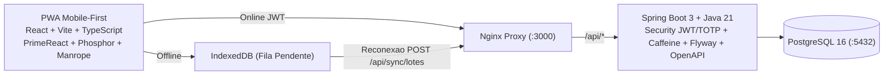
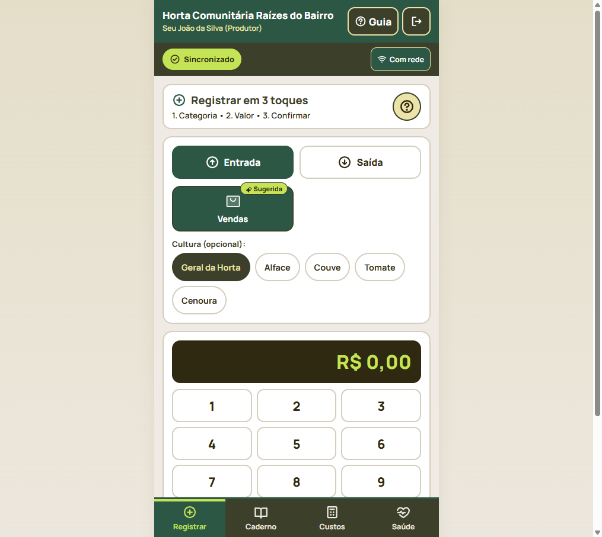
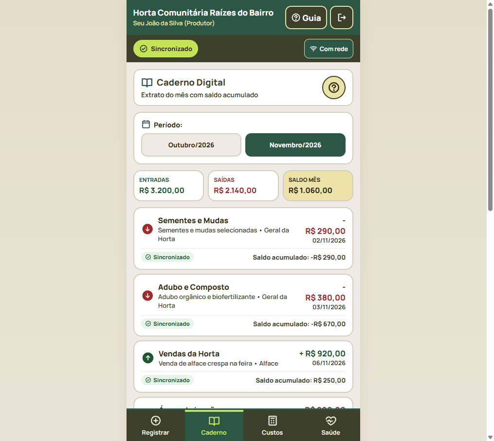
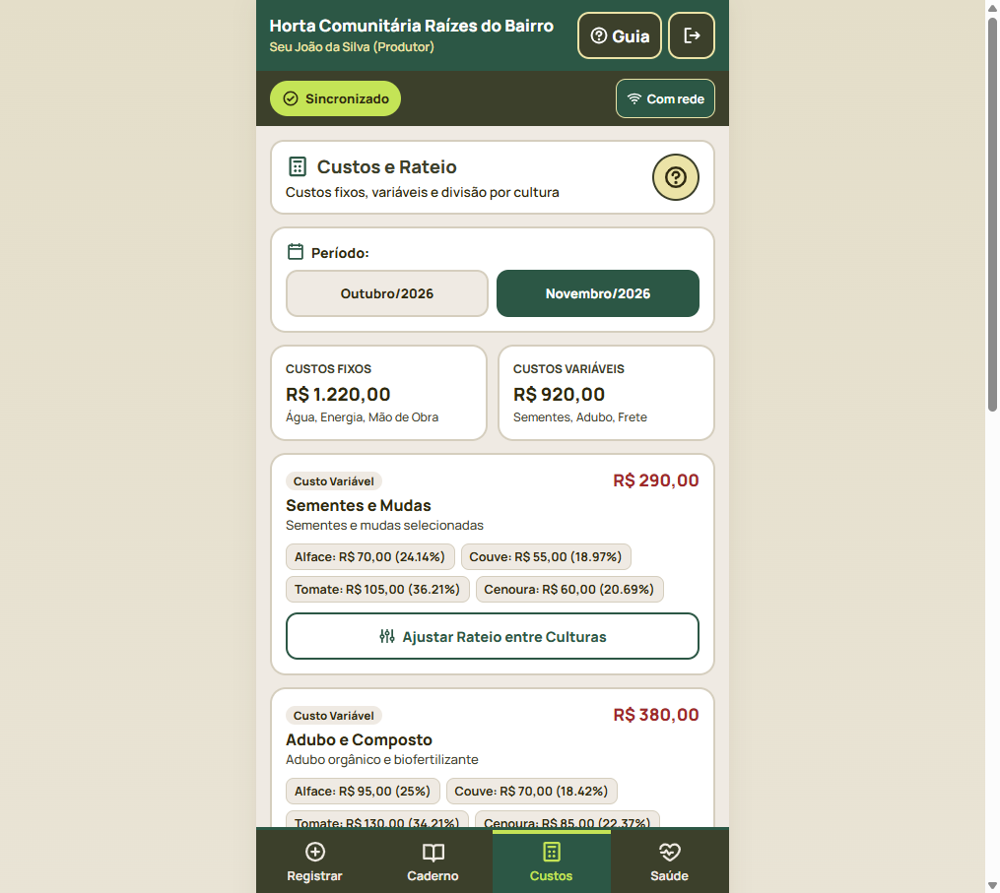
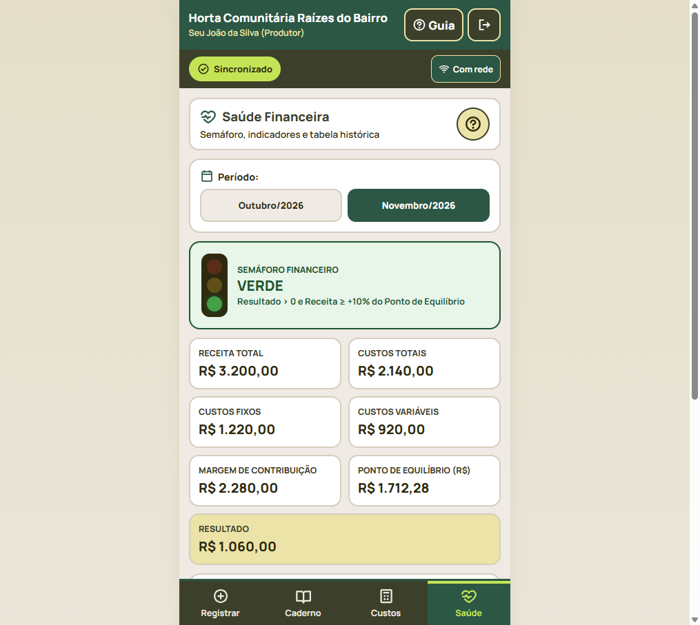

# Módulo de Planejamento Financeiro — Agricultura Urbana e Periurbana

MVP do **Módulo de Planejamento Financeiro** da Plataforma Integrada para Agricultura Urbana e Periurbana, projetado para pequenos produtores rurais e gestores de hortas comunitárias com baixo letramento digital, utilizando smartphones de entrada (**Android 9, 2 GB de RAM, tela de 5,5 pol., rede 3G intermitente**).

- **Repositório GitHub:** https://github.com/maththe/modulo-planejamento-financeiro
- **Demonstração Online (Modo Demo sem backend e sem exigir TOTP):** https://maththe.github.io/modulo-planejamento-financeiro/

---

## Sumário

1. [Funcionalidades do MVP](#funcionalidades-do-mvp)
2. [Arquitetura e Stack Tecnológica](#arquitetura-e-stack-tecnológica)
3. [Como Executar com Docker Compose](#como-executar-com-docker-compose)
4. [Usuários de Teste (Seed via Flyway)](#usuários-de-teste-seed-via-flyway)
5. [Passo a Passo do TOTP (Google Authenticator) do Gestor](#passo-a-passo-do-totp-google-authenticator-do-gestor)
6. [Testes Automatizados e CI/CD](#testes-automatizados-e-cicd)
7. [Prints das Telas](#prints-das-telas)

---

## Funcionalidades do MVP

### Entregues no MVP
- **Onboarding ilustrado (3 telas)** com botão **"?" de ajuda contextual** em cada etapa do tutorial e no cabeçalho de todas as telas do aplicativo.
- **Registro rápido em até 3 toques:** Entrada ou Saída → categoria por ícone grande (com sugestão automática baseada no histórico do produtor) → valor no teclado numérico ampliado → Confirmar.
- **API de lançamentos recorrentes** (`GET/POST/DELETE /api/lancamentos-recorrentes` e geração de lançamento).
- **CRUD de lançamentos na API** com validação e exclusão lógica (`excluido = true`).
- **Caderno Digital:** extrato mensal com seletor de período, total de entradas/saídas e **saldo acumulado** lançamento a lançamento.
- **Custos Fixos e Variáveis & Rateio por Cultura:** separação entre custos fixos (`Água`, `Energia`, `Mão de Obra`) e variáveis (`Sementes`, `Adubo`, `Frete`), rateio entre `Alface`, `Couve`, `Tomate` e `Cenoura` (com validação estrita de que a soma dos rateios é igual ao custo total) e **fechamento de período pela API** (`POST /api/periodos/{anoMes}/fechar`), que congela o resultado do mês.
- **Motor de Indicadores (com cache Caffeine):**
  - $\text{Custo Unitário} = \text{Custo Total da Cultura} \div \text{Quantidade Produzida}$
  - $\text{Margem de Contribuição} = \text{Receita} - \text{Custos Variáveis}$
  - $\text{Ponto de Equilíbrio (R\$)} = \text{Custos Fixos} \div (\text{Margem de Contribuição} \div \text{Receita})$
  - $\text{Resultado} = \text{Receita} - \text{Custos Totais}$
  - Tratamento seguro de margem nula ou negativa exibindo aviso técnico (nunca divisão inválida).
  - **Série histórica mensal em tabela.**
- **Painel de Saúde Financeira com Semáforo:**
  - **VERDE:** resultado positivo e receita pelo menos 10% acima do ponto de equilíbrio.
  - **AMARELO:** resultado positivo, mas abaixo da margem de +10% sobre o ponto de equilíbrio.
  - **VERMELHO:** resultado negativo (ou $\le 0$).
  - Exibição exclusivamente com nomes técnicos (sem textos em linguagem cotidiana e sem gráficos).
- **Operação Offline (PWA + IndexedDB):**
  - Service Worker (`sw.js`) e fila offline no IndexedDB marcada como `Pendente`.
  - Envio em lote ao reconectar para `POST /api/sync/lotes` com chave de idempotência por lançamento (reenvios idênticos não duplicam dados) e processamento individual com suporte a lote parcial.
  - Resolução de conflitos pela regra **"última escrita vence"** (`ULTIMA_ESCRITA_VENCE`) com controle de `versao` e tabela `conflitos_sincronizacao`.
  - Barra de status na tela mostrando: **Sincronizando**, **Pendente**, **Sincronizado** ou **Conflito**.

### Fora do Escopo do MVP (Não Implementado Intencionalmente)
- Mensagens dos indicadores em linguagem cotidiana.
- Gráficos de evolução.
- Telas de edição e exclusão de lançamentos no frontend.
- Tela de atalhos de lançamentos recorrentes no frontend.
- Tela de fechamento de período no frontend.

---

## Arquitetura e Stack Tecnológica



### Tecnologias e Identidade Visual
- **Backend:** Java 21, Spring Boot 3.3.5 (Web, Data JPA, Security, Validation, Cache/Caffeine), Flyway, PostgreSQL 16, springdoc-openapi, JJWT 0.12.6, TOTP RFC 6238 (`HmacSHA1`).
- **Frontend:** React 18, Vite 5, TypeScript, PrimeReact, `@phosphor-icons/react`, fonte Google Fonts **Manrope**, PWA (`manifest.webmanifest` + `sw.js`) e IndexedDB.
- **Acessibilidade e Paleta Obrigatória:** alvos de toque mínimos de **48 px**, alto contraste, textos curtos sem jargão nos menus e paleta:
  - `#3C402B` (Oliva Escuro)
  - `#2C5745` (Verde Floresta)
  - `#2E2910` (Terra Escuro)
  - `#EBE3A7` (Amarelo Palha)
  - `#EFEAE3` (Bege Areia)
  - `#C4E456` (Verde Lima)

---

## Como Executar com Docker Compose

> Pré-requisitos: Docker e Docker Compose instalados.

1. Clone o repositório e entre na pasta do projeto:
   ```bash
   git clone https://github.com/maththe/modulo-planejamento-financeiro.git
   cd modulo-planejamento-financeiro
   ```

2. **Obrigatório:** crie o arquivo `.env` a partir do exemplo antes de subir os contêineres (o `docker-compose.yml` recusa subir sem `.env` para não expor credenciais padrão no repositório):
   ```bash
   cp .env.example .env
   ```
   *(No Windows PowerShell: `Copy-Item .env.example .env`)*

3. Suba todos os serviços (`db`, `backend` e `frontend`) com um único comando:
   ```bash
   docker compose up --build
   ```

4. Acesse os serviços:
   - **Aplicação Web (PWA):** http://localhost:3000
   - **Documentação OpenAPI (Swagger UI):** http://localhost:8080/swagger-ui.html
   - **Healthcheck Backend:** http://localhost:8080/api/health
   - **PostgreSQL:** `localhost:5432` (credenciais definidas em `.env`)

---

## Usuários de Teste (Seed via Flyway)

A migração `V2__seed_data.sql` cria a **Horta Comunitária Raízes do Bairro** (Curitiba/PR) com as culturas **Alface**, **Couve**, **Tomate** e **Cenoura** e cerca de 2 meses de lançamentos (`2026-10` e `2026-11`) com vendas, sementes, adubo, água, energia, frete e mão de obra.

| Perfil | Nome | Login | Senha | TOTP no Login (Docker/API) | Acesso |
| --- | --- | --- | --- | --- | --- |
| `PRODUTOR` | Seu João da Silva | `joao.silva` | `123456` | Não | Próprios dados (leitura e escrita) |
| `PRODUTOR` | Dona Maria dos Santos | `maria.santos` | `123456` | Não | Próprios dados (leitura e escrita) |
| `GESTOR` | Carlos Eduardo | `carlos.gestor` | `123456` | **Sim (Obrigatório)** | Produtores da sua horta em **modo leitura** |

> **Observação:** Na demonstração online publicada no GitHub Pages (`VITE_DEMO_MODE=true`), os dados são simulados no navegador e o login do gestor dispensa o código TOTP.

---

## Passo a Passo do TOTP (Google Authenticator) do Gestor

Quando o sistema estiver rodando com o backend real (`docker compose up`), o usuário **`carlos.gestor`** exige um código TOTP de 6 dígitos no login:

1. Instale o aplicativo **Google Authenticator** no seu celular (Android ou iOS).
2. Abra o aplicativo e toque no botão **`+`** (Adicionar conta).
3. Selecione **"Inserir chave de configuração"** (Setup key).
4. Preencha os campos exatamente assim:
   - **Nome da conta:** `Horta Raízes - Gestor`
   - **Sua chave:** `JBSWY3DPEHPK3PXP`
   - **Tipo de chave:** `Com base no horário` (Time-based / TOTP, 30 segundos, 6 dígitos)
   - *(Opcional via QR Code / URI `otpauth://totp/Horta%20Raizes:carlos.gestor?secret=JBSWY3DPEHPK3PXP&issuer=Horta%20Raizes`)*
5. Toque em **Adicionar**.
6. Na tela de login da aplicação web, selecione **Carlos Eduardo (`carlos.gestor`)**, informe a senha `123456`, digite o código atual de 6 dígitos mostrado no Google Authenticator e clique em **Entrar no Sistema**.

---

## Testes Automatizados e CI/CD

### Executar testes do Backend localmente
Requer JDK 21 (ou compatível) e acesso ao Maven Central na primeira execução:
```bash
cd backend
./mvnw clean test
```
*(No Windows PowerShell: `.\mvnw.cmd clean test`)*

Os testes cobrem:
- `CalculadoraIndicadoresServiceTest`: cenários `VERDE`, `AMARELO`, `VERMELHO`, cálculo de custo unitário por cultura, e casos explícitos de **margem de contribuição nula (`= 0`)** e **margem negativa (`< 0`)** sem divisão inválida.
- `SincronizacaoControllerIdempotenciaTest`: envio em lote, **idempotência** em reenvio idêntico, **conflito ("última escrita vence")** com log em `conflitos_sincronizacao`, **lote parcial**, obrigatoriedade de **TOTP do gestor** e **bloqueio de escrita (`403`) para gestor**.

### Esteiras GitHub Actions
- `.github/workflows/ci.yml`: verificação de segredos com **Gitleaks**, build/testes do backend (`./mvnw -B clean test`) e build TypeScript/Vite do frontend.
- `.github/workflows/deploy-pages.yml`: build estático do frontend em modo demo (`VITE_DEMO_MODE=true`) e publicação automática no **GitHub Pages**.

---

## Prints das Telas

| Onboarding (Botão "?" e 3 etapas) | Registro Rápido (Até 3 toques) | Caderno Digital (Saldo Acumulado) |
| :---: | :---: | :---: |
|  |  |  |

| Custos Fixos/Variáveis e Rateio | Saúde Financeira e Semáforo |
| :---: | :---: |
|  |  |
